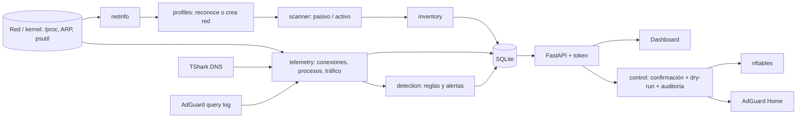

# Arquitectura
Un solo proceso Python (FastAPI + tareas asyncio) con almacenamiento SQLite. Los módulos del documento de requisitos se corresponden así:

| Componente | Módulo |
|---|---|
| Desktop Agent (cambios de red, tareas) | `monitor.py`, `netinfo.py` |
| Network Scanner | `scanner.py`, `oui.py`, `inventory.py` |
| Escucha pasiva | `sniffer.py` (proceso aparte con cap_net_raw), `fingerprint.py`, `inventory.observe` |
| Telemetry Engine | `telemetry.py`, `detection.py` |
| Backend API | `api.py` (FastAPI) |
| Database | `db.py` (SQLite WAL; SQL estándar para migrar a PostgreSQL) |
| Network Access Control | `control.py`, `integrations/` |
| Perfiles / Auto-Discovery | `profiles.py` |
| Informes / Investigación | `reports.py`, vista *Investigación* |
| Dashboard | `dashboard/` (HTML+JS+CSS sin dependencias externas) |

## Reconocimiento de redes
Puntaje por señales: MAC del gateway (5), subred (1), SSID (1), IP del gateway (1), DNS (1), dispositivos conocidos que reaparecen (2). Umbral 5 (3 si ninguna de las dos partes tiene MAC de gateway). Mismo SSID/subred con otro gateway se trata como red distinta; misma red con otra MAC de gateway genera alerta `GATEWAY_MAC_CHANGED`.

## Modelo de seguridad
Pasivo por defecto → autorización por red → control habilitado → dry-run → ejecución real. Ver `SECURITY.md`.
